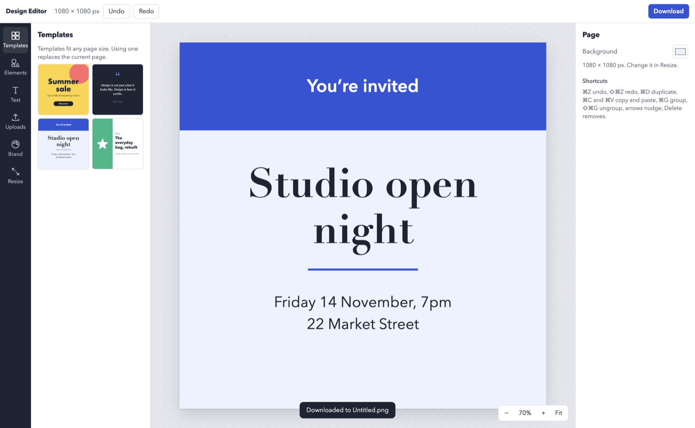

# Design Editor

A free, offline design editor for the Mac, in the spirit of Canva. Make social posts, posters, invites and thumbnails, then download them as PNG, JPG, SVG or PDF. It has no account or subscription and doesn't need the internet. Your files stay on your computer.



## Features

- **Templates** that fit any page size: a sale poster, a quote card, an event invite and a product launch
- **Elements**: shapes, lines and stars, plus heading, subheading and body text
- **Uploads**: drop, paste or pick images
- **Magic resize**: switch between nine presets (Instagram post and story, YouTube thumbnail, A4, presentation and more) or a custom size, with the content scaled to fit
- **Brand kit**: saved brand colours, applied with one click, and heading and body fonts that new text uses
- **Background remover** for product shots and logos on plain backgrounds, with an adjustable tolerance
- **Image adjustments**: brightness, contrast, blur, and black and white
- **Editing**: layers, grouping, locking, flipping, aligning to the page, snapping to the page centre, and undo and redo
- **Downloads**: PNG, transparent PNG, JPG, SVG or PDF at 1×, 2× or 3×
- **Mac app behaviour**: native menus and Open and Save dialogs, and the title bar shows unsaved changes. Every change is autosaved, so quitting never loses work.

## Install

You need [Node.js](https://nodejs.org) 20 or later.

```sh
git clone https://github.com/haroongondal/design-editor.git
cd design-editor
npm install
npm run dist
```

That builds `dist/Design Editor-darwin-arm64/Design Editor.app`. Drag it into Applications. The app isn't code-signed, so the first time you open it, right-click it and choose **Open**.

To run it from source without building, use `npm start`.

## Shortcuts

| Action | Keys |
| --- | --- |
| Undo, redo | ⌘Z, ⇧⌘Z |
| Copy, cut, paste | ⌘C, ⌘X, ⌘V |
| Duplicate | ⌘D |
| Group, ungroup | ⌘G, ⇧⌘G |
| Nudge by 1 px, by 10 px | Arrow keys, ⇧ + arrow keys |
| Delete | Delete |
| Save, save as | ⌘S, ⇧⌘S |
| Download | ⇧⌘E |
| Zoom in, out, fit | ⌘=, ⌘−, ⌘0 |

## Limitations

- The background remover clears the plain colour around the edges of an image. It isn't an AI model, so busy photo backgrounds won't come out cleanly.
- Text uses the fonts installed on your Mac. A design opened on another computer may look different.
- In PDF downloads the page is an image, so the text can't be selected.
- Each window holds one page.
- Builds are for Apple Silicon Macs.

## Development

```sh
npm start   # run from source
npm test    # drive the real app end to end, with the file dialogs stubbed
npm run dist
```

- **`main.js`**: menus, file dialogs, file writes and autosave.
- **`preload.cjs`**: the small bridge the page uses to reach them.
- **`index.html` and `app.js`**: the editor itself, built on [Fabric.js](https://fabricjs.com) 7.
- **`vendor/`**: Fabric.js and [pdf-lib](https://pdf-lib.js.org), both MIT licensed, bundled so the app works offline.
